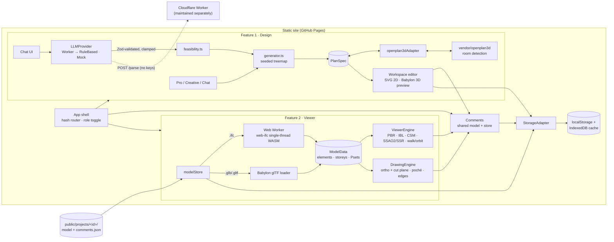

# Architect Tool POC

A **fully static** proof of concept for a residential architecture practice, deployable to GitHub Pages:

* **Feature 1 – Design it yourself.** Non-architects sketch a layout (Pro), pick a generated layout that fits their size and budget (Creative), or describe their wishes in a chat (Tell us). All three produce a `PlanSpec` that opens in a friendly, touch-first editor with comments.
* **Feature 2 – Walk & comment.** The architect publishes an IFC or GLB model. The client views watermarked 2D drawings (plans, reflected ceiling plan, sections, elevations) or walks through a photoreal 3D scene, and pins comments exactly where they mean.

Everything runs in the browser. The only external call is the optional LLM Cloudflare Worker, which is treated as a black box (see [`docs/llm-worker-contract.md`](docs/llm-worker-contract.md)).

## Quick start

```bash
npm ci
npm run dev          # http://localhost:5173
npm test             # Vitest: feasibility, generator, adapters, LLM validation/fallback, IFC parsing
npm run build        # → dist/ (base path /arch-poc/ unless BASE_PATH is set)
npm run check        # svelte-check / TypeScript
npx tsx scripts/build-samples.ts   # re-bake the sample GLB + example design bundle
npx tsx scripts/ifc-batch.ts <dir> # parse every .ifc in a folder (robustness / timing report)
python3 scripts/make-textured-ifc.py <ambientCG-dir>  # re-author the textured IFC sample (needs ifcopenshell, pillow)
```

Optional: copy `.env.example` to `.env` and set `VITE_LLM_WORKER_URL` to try the Worker locally. Add `?llm=mock` to the chat URL (`#/design/chat?llm=mock`) to use canned responses.

## Deploying to GitHub Pages

1. **Settings → Pages → Build and deployment → Source: GitHub Actions.**
2. *(Optional, for AI chat)* **Settings → Secrets and variables → Actions → Variables → New repository variable**: `VITE_LLM_WORKER_URL` = `https://<your-worker>.workers.dev`. Use a *variable*, not a secret. It's a public URL and the Worker holds the keys.
3. Push to `main`. `.github/workflows/deploy.yml` installs, runs the tests, builds with `BASE_PATH=/<repo-name>/` and deploys.

Routing is hash-based (`/#/design`, `/#/viewer/walk`…), so refreshing any route works on Pages. The IFC parser uses the **single-thread** web-ifc WASM build, because Pages can't send COOP/COEP headers (no `SharedArrayBuffer`).

## Routes

| Route | What |
|---|---|
| `#/` | Landing page with two feature cards |
| `#/design` | Choose a mode (Pro / Creative / Tell us), recent plans, import, example plan with comments |
| `#/design/creative` | Template wizard: size → rooms (infeasible options disabled with reasons) → 3–6 variants |
| `#/design/chat` | Chat → editable requirement chips → feasibility check → variants |
| `#/design/workspace?id=…` | Editor: ✏️ Edit / 💬 Comment, 2D/3D, undo/redo, autosave, *Send to architect* |
| `#/viewer` (`?project=<id>`) | Load a published project, a demo sample, or upload IFC/GLB (Architect role) |
| `#/viewer/plan` | Watermarked 2D drawings with comments and PNG/PDF export |
| `#/viewer/walk` (`?comment=<id>`) | 3D walkthrough / orbit, minimap, time of day, quality presets, spatial comments |
| `#/comments` | All comments: filter, resolve (architect), export/import JSON |

The header has a **Client / Architect** toggle (demo only, no auth). Architects can upload models, resolve comments and hide the watermark. Clients can edit plans and comment.

## Architecture



### Folder structure

```
src/
  App.svelte, main.ts, app.css
  shared/          router, StorageAdapter (+ local impl), comments (model, store, UI), planspec schema, model types, UI kit
  features/
    landing/
    design/        DesignHome, CreativeWizard, ChatMode
      generator/   feasibility.ts, generator.ts, templates.ts
      llm/         WorkerProvider, RuleBasedProvider, MockProvider, FallbackProvider, Zod schemas
      engine/      openplan3dAdapter.ts, plan3d.ts (PlanSpec → 3D), planSvg.ts
      workspace/   Workspace, PlanCanvas (touch editor), editor.svelte.ts (ops, history, anchors), Preview3D
    viewer/        ViewerHome, WalkView, PlanView, Minimap, Joystick
      model/       ifcParse.ts, ifc.worker.ts, glbLoad.ts, modelStore.ts, slice.ts
      engine/      ViewerEngine.ts (3D), DrawingEngine.ts (2D), materials.ts
    comments/      CommentsPage
vendor/openplan3d/ vendored geometry core (MIT) + MODIFICATIONS.md
public/            samples/ (duplex.ifc, family-home.glb, example bundle), projects/, env/
docs/              llm-worker-contract.md
tests/             Vitest suites
```

### Stack and the reasons behind each choice

* **Vite + TypeScript + Svelte 5.** We chose Svelte over React because openPlan3D, the editor we adapt, is Svelte, and because Svelte compiles to small bundles, which keeps the landing page fast (Lighthouse mobile: Performance 96, Accessibility 100 locally).
* **Svelte stores / runes** instead of Zustand. They're the idiomatic Svelte equivalent, so we don't need an extra dependency.
* **Babylon.js 9** for every 3D view: the walkthrough, the 2D drawings and the workspace preview. openPlan3D's three.js viewer is *not* used, so the app ships one 3D engine, not two.
* **web-ifc** directly rather than That Open Engine components. Those are built on three.js; we only need the parser. It runs in a Web Worker with the single-thread WASM.
* **Tailwind CSS 4**, **Zod 4**, **lz-string** (share links), **jsPDF** (lazy-loaded).
* **Lazy loading.** Babylon, web-ifc and jsPDF only download on the routes that need them. The landing page loads about 60 KB of JS (gzip).

## How the features work

### Feature 1

* **PlanSpec** (`src/shared/planspec/schema.ts`): a Zod schema in metres. Every mode produces it. `planSpecToOpenPlan3D()` and `openPlan3DToPlanSpec()` convert to and from openPlan3D's centimetre model.
* **Feasibility** (`generator/feasibility.ts`): minimum room areas, +15 % circulation, +12 % walls, +6 m² of stairs per extra floor, and a minimum floor-plate size. For example, 60 m² on one floor allows 2 bed 1 bath, while 3 bed shows “Needs ~70 m²+”. Infeasible options are shown greyed out with the reason, not hidden.
* **Generator** (`generator/generator.ts`): deterministic and seeded (mulberry32). The footprint is split into a private band, a full-width hallway spine and a public front band. Each band is a strip treemap, so every room touches the hallway and an exterior wall. Wet areas are grouped. The main bedroom gets an ensuite and walk-in robe. Living and kitchen are joined by a wide opening. The entry and garage door are always on the front, and stairs line up across floors. Doors go on shared walls and windows on exterior walls. The same inputs and seed always give the same plan (tested).
* **Chat**: `FallbackProvider` tries the `WorkerProvider` (15 s timeout) and falls back to the `RuleBasedProvider` (regex/keywords, understands short answers like “2”) when the URL is unset, on errors, on HTTP 429 or on invalid output. Fallback shows the badge “Offline mode – simplified parsing”. Parsed requirements appear as editable chips. Infeasible briefs get an explanation plus one-tap suggestions (“Use 2 bed 1 bath + study” or “Make it 85 m²”).
* **Workspace**: tools Move, Add a room (drag, or tap for a 3.6 × 3 m room), Draw wall, Add door, Add window and Remove. It snaps to a 10 cm grid, wall corners and walls. Room areas update live through openPlan3D room detection. Moving a wall drags the walls attached to it along. Other features: undo/redo, autosave, coach marks in Pro mode, an Advanced drawer, pinch-zoom, long-press to grab on touch, and bottom sheets.
* **Comments in the workspace**: each pin is anchored to an element id plus local coordinates (position along a wall and side offset, or offset from a room's centroid), so it **follows the element when it moves**. A comment can carry a category and a photo (stored as a base64 thumbnail).
* **Send to architect**: a JSON bundle (PlanSpec + comments + requirements), or a compressed `#/design/workspace?share=…` link for small plans.

### Feature 2

* **Loading**: drag and drop, file picker (Architect role), demo samples, or published projects. Progress comes from the worker. Parsed models are cached in IndexedDB. Large files (> 25 MB on phones, > 150 MB on desktop) prompt for a *simplified* load without furniture or small parts.
* **IFC metadata**: each mesh keeps its `expressID`, GlobalId, class, name, storey (via `IfcRelContainedInSpatialStructure` / `IfcRelAggregates`) and flattened Psets. Render meshes are merged per *storey × material* for fewer draw calls, and invisible per-element meshes handle picking and collisions.
* **IFC textures**: web-ifc only outputs colours, so `model/ifcTextures.ts` reads textures from the IFC itself:
  * The three texture kinds are `IfcImageTexture` (external image), `IfcBlobTexture` (embedded JPG/PNG) and `IfcPixelTexture` (raw pixels).
  * They can be attached per representation item (`IfcStyledItem` → `IfcSurfaceStyleWithTextures`, including IFC2x3 `IfcPresentationStyleAssignment`) or per material (`IfcMaterialDefinitionRepresentation` + `IfcRelAssociatesMaterial`).
  * Explicit UVs come from `IfcIndexedTriangleTextureMap`. They're matched onto web-ifc's re-centred triangles by shape, so unit scaling and re-centring are handled.
  * Without explicit UVs, textures are box-mapped in metres and scaled by `TextureTransform`.
  * External images are fetched relative to the model URL (same-origin only). For uploads, select or drop the image files together with the `.ifc`; missing images are reported and fall back to the material colour.
* **Rendering**: PBR material library (timber floor, concrete, plaster, tile, glass, brushed metal, grass, roof), with procedural textures, so there are no texture downloads. Lighting is HDR IBL plus a directional sun with cascaded shadow maps and a time-of-day slider. Post-processing uses `DefaultRenderingPipeline` (ACES tone mapping, bloom, FXAA, vignette), SSAO2 at Medium and High, and SSR at High on desktop. There's a sky and a ground plane. Glass is transparent and has no collisions, and neither do door leaves, so you can walk through doorways.
* **Quality presets**: Low (phones: lower resolution, 2 shadow cascades, no AO), Medium and High (desktop). The default is detected automatically and can be overridden in ⚙️.
* **Walk**: on desktop, WASD or the arrow keys plus pointer-lock mouse look, and double-click the floor to walk there. On mobile, a joystick (left), drag to look, and tap the floor to walk there. Eye height is 1.6 m, with collisions, gravity and a step-up ground follower for stairs. There's also an orbit mode, a minimap (tap to walk there), “Go inside”, and a storey cut-away.
* **3D comments**: 💬 freezes movement. Tapping raycasts and stores the world position, surface normal, element id / `expressID`, storey, a camera snapshot and a thumbnail. Pins are billboards. Tapping a pin opens the thread, and **Go to view** flies back to the exact viewpoint.
* **2D drawings**: an orthographic camera with a cut plane. A custom shader discards geometry beyond the cut and draws the cut solids as dark poché; edges are drawn with Babylon's edges renderer (clipped by the same plane). The set covers floor plans at storey + 1.2 m, the **reflected ceiling plan** (looking up, mirrored), Section A–A and B–B, and four elevations. Every view has a storey selector, scale bar, north arrow, and pan/zoom. The diagonal **“DRAFT — NOT FOR CONSTRUCTION”** watermark is drawn on screen and baked into PNG/PDF exports, and the Client role can't turn it off. 2D comments share the 3D anchor model, so they appear in both views.

### Walkthrough controls & doors/windows

- **Move:** WASD (arrows: forward/back + turn), **Shift** to run. Walk 4.3 m/s, run 7.5 m/s. Mobile: joystick + drag to look.
- **Minimap:** tap to glide there, drag your marker to move live, ▲/▼ to change floor, ⤢ to enlarge.
- **3D floor plans (orbit):** in orbit mode the minimap's ▲/▼ cut the building horizontally. **Roof** shows the whole closed building; each floor below removes everything more than 1.3 m above that floor (roof, upper storeys, the top of its own walls), so you look down into its rooms. Walking always switches back to the whole building.
- **Doors & windows:** look at one and press **E** (or F, or click/tap it) to open or close it. Closed doors block you.
- **Which way they open** (`src/features/viewer/engine/openings.ts`):
  - IFC operation type is read from the element (IFC4 `IfcDoor.OperationType`) or its type (`IfcDoorStyle`/`IfcDoorType`, `IfcWindowPanelProperties`): `SINGLE_SWING_LEFT/RIGHT`, `DOUBLE_DOOR_*`, `SLIDING_TO_LEFT/RIGHT`, `ROLLINGUP`, `SIDEHUNG*`, `TOPHUNG`, `BOTTOMHUNG`, `PIVOT*`, `SLIDING*`, `FIXEDCASEMENT`...
  - Hinge side and swing side follow the IFC convention: a door swings towards its local +Y, and left/right is the hinge side seen looking along +Y (local axes come from the `IfcLocalPlacement` chain).
  - When the file doesn't say: name hints (fixed, casement, slider, awning...) and size; doors then swing away from you, casements open inwards.
  - The moving leaf is separated from the lining/frame geometrically (pieces inset from the frame move).

## Architect publishing workflow (the POC's stand-in for a backend)

1. Create `public/projects/<id>/project.json`:

   ```json
   {
     "id": "duplex",
     "title": "Duplex townhouses",
     "versionId": "v2",
     "versionLabel": "Version 2 · Design development",
     "previousVersion": "Version 1 · Concept",
     "model": "../../samples/duplex.ifc",
     "comments": "comments.json",
     "publishedAt": "2026-11-19T09:00:00.000Z"
   }
   ```

   `model` may be a file in the same folder (`model.ifc` / `model.glb`) or a relative path.
2. Optionally add `comments.json` (an array of comments, e.g. exported from `#/comments`) and list the project in `public/projects/index.json`.
3. Commit and push. Pages redeploys. Send the client `https://<owner>.github.io/<repo>/#/viewer?project=<id>`.
4. The client's comments are stored **locally** on their device. They use **Comments → Export** (or *Send to architect* in the design workspace) and send the JSON back. The architect imports it at `#/comments` (or the design page), replies and resolves, then exports an updated `comments.json` into the next published version.

The repo ships `public/projects/duplex/` (the duplex IFC, version label, “Compare with previous version” placeholder, and five pre-filled client/architect comments in 2D and 3D, with snapshots and replies).

## Demo content

* `public/samples/duplex.ifc`: IFC 2x3 sample (2 storeys plus foundation and roof, about 270 elements, Psets).
* `public/samples/textured-cottage/`: a properly **textured IFC4** model (authored with IfcOpenShell by `scripts/make-textured-ifc.py`, CC0 photo textures). It exercises every way IFC carries textures, see below.
* `public/samples/family-home.glb`: GLB baked from the seeded *Family Home* template (`scripts/build-samples.ts`).
* Three seeded templates: *The Cottage*, *The Family Home* and *The Townhouse* (`generator/templates.ts`).
* Pre-filled comments: `public/projects/duplex/comments.json` (viewer) and `public/samples/example-design-bundle.json` (workspace: **Design → Open example with comments**).

## Persistence

`StorageAdapter` (`src/shared/storage/StorageAdapter.ts`) is the only persistence boundary. `LocalStorageAdapter` keeps plans, comments and preferences in `localStorage` and parsed models in IndexedDB. Everything round-trips through JSON export and import. A REST, Supabase or Firebase backend can implement the same interface without UI changes.

## Known limitations (POC)

* **No backend or auth.** The role toggle is cosmetic; data stays on each device and travels as JSON files or share links.
* **Compare with previous version** is a labelled placeholder (“coming soon”).
* **Performance on real phones is unverified.** It was checked only in headless Chromium with software WebGL (SwiftShader). The Low preset is designed for ≥30 fps on mid-range phones; confirm on real devices before relying on it.
* **Drawings**: poché depends on the model's normals being consistent. Open or flipped IFC geometry can show dark patches. There are no dimensions, annotations or hatching standards yet.
* **IFC**: very large models parse on the device. The single-thread WASM is slower than the multi-thread build. The simplified mode only drops furniture and small classes, with no mesh decimation.
* **Generator**: it uses rectangular footprints only, with a three-band layout. Very large briefs get long, narrow rooms. Multi-storey plans may add a bathroom on upper floors.
* **The rule-based chat parser** covers common phrasings only. The Worker is expected to do the heavy lifting.
* **GLB** materials map to the curated library by name keywords. Embedded textures are not kept.
* **IFC textures**: `IfcIndexedPolygonalTextureMap` and `IfcTextureCoordinateGenerator` parameters are not interpreted; those fall back to box mapping. Real-world exports (Revit, Archicad, Tekla) rarely contain textures at all; they carry colours, which map to the curated PBR library. See [`docs/ifc-compatibility.md`](docs/ifc-compatibility.md) for the models tested.

## Next steps

* A backend (behind `StorageAdapter`) for projects, versions and comments, with auth (magic links for clients, SSO for staff) and roles enforced on the server.
* Real-time sync for comments (WebSocket or Durable Objects), and notifications.
* Version diffing (element GlobalId diff → highlight added, removed and changed elements).
* Dimensioned drawings, room tags from `IfcSpace`, sheet layouts and title blocks.
* Model optimisation pipeline (Draco/meshopt GLB, LODs) for large projects on phones.
* Furniture and finishes in the client editor, reusing more of openPlan3D's catalogue.
