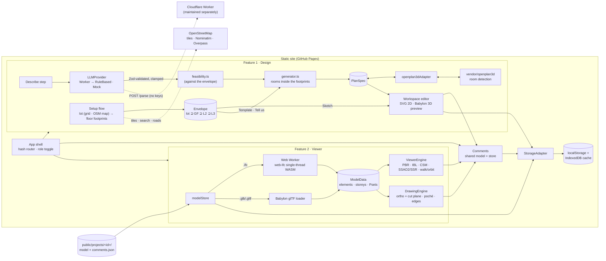

# Architect Tool POC

A **fully static** proof of concept for a residential architecture practice, deployable to GitHub Pages:

* **Feature 1 – Design it yourself.** Every design starts from the client's own envelope: the **lot** (drawn on a 1 m grid or traced over an OpenStreetMap map) and the **footprint of each floor** (lot ⊇ ground floor ⊇ level 2 ⊇ level 3). Then the client either sketches the rooms themselves (Sketch it yourself) or lets us generate them inside those footprints, from a template (Start from a template) or from a chat (Just tell us). All three produce a `PlanSpec` that opens in a friendly, touch-first editor with comments.
* **Feature 2 – Walk & comment.** The architect publishes an IFC or GLB model. The client views watermarked 2D drawings (plans, reflected ceiling plan, sections, elevations) or walks through a photoreal 3D scene, and pins comments exactly where they mean.

Everything runs in the browser. The external calls are the optional LLM Cloudflare Worker, which is treated as a black box (see [`docs/llm-worker-contract.md`](docs/llm-worker-contract.md)), and OpenStreetMap services, used only when a client chooses to find their lot on a map (tiles, address search and road data; see [Lot from a map](#lot-from-a-map-openstreetmap)).

## Quick start

```bash
npm ci
npm run dev          # http://localhost:5173
npm test             # Vitest: envelope hierarchy, generator (L/U/T/diagonal/multi-storey footprints), feasibility, OSM helpers, editor, adapters, LLM, IFC
npm run build        # → dist/ (base path /arch-poc/ unless BASE_PATH is set)
npm run check        # svelte-check / TypeScript
npx tsx scripts/build-samples.ts   # re-bake the sample GLB + example design bundle
npx tsx scripts/ifc-batch.ts <dir> # parse every .ifc in a folder (robustness / timing report)
python3 scripts/make-textured-ifc.py <ambientCG-dir>  # re-author the textured IFC sample (needs ifcopenshell, pillow)
```

Optional: copy `.env.example` to `.env` and set `VITE_LLM_WORKER_URL` to try the Worker locally. Add `&llm=mock` to the setup URL of a *Just tell us* plan (`#/design/setup?id=…&llm=mock`) to use canned chat responses. `VITE_TILE_URL`, `VITE_GEOCODER_URL` and `VITE_OVERPASS_URL` swap the OpenStreetMap services (see below).

## Deploying to GitHub Pages

1. **Settings → Pages → Build and deployment → Source: GitHub Actions.**
2. *(Optional, for AI chat)* **Settings → Secrets and variables → Actions → Variables → New repository variable**: `VITE_LLM_WORKER_URL` = `https://<your-worker>.workers.dev`. Use a *variable*, not a secret. It's a public URL and the Worker holds the keys.
3. Push to `main`. `.github/workflows/deploy.yml` installs, runs the tests, builds with `BASE_PATH=/<repo-name>/` and deploys.

Routing is hash-based (`/#/design`, `/#/viewer/walk`…), so refreshing any route works on Pages. The IFC parser uses the **single-thread** web-ifc WASM build, because Pages can't send COOP/COEP headers (no `SharedArrayBuffer`).

## Routes

| Route | What |
|---|---|
| `#/` | Landing page with two feature cards |
| `#/design` | Choose a mode (Sketch / Template / Tell us), recent plans (they reopen at the step they were left at), import, example plan with comments |
| `#/design/setup?id=…` | The workflow before the editor. Sketch: **Lot → Ground floor**. Template: **Lot → All floors → Template → Pick a layout**. Tell us: **Lot → All floors → Describe → Pick a layout** |
| `#/design/sketch`, `#/design/creative`, `#/design/chat` | Start a new plan in that mode (goes to the lot step) |
| `#/design/workspace?id=…` | Editor: ✏️ Edit / 💬 Comment, 2D/3D, undo/redo, autosave, footprint tool, *Send to architect* |
| `#/viewer` (`?project=<id>`) | Load a published project, a demo sample, or upload IFC/GLB (Architect role) |
| `#/viewer/plan` | Watermarked 2D drawings with comments and PNG/PDF export |
| `#/viewer/walk` (`?comment=<id>`) | 3D walkthrough / orbit, minimap, time of day, quality presets, spatial comments |
| `#/comments` | All comments: filter, resolve (architect), export/import JSON |

The header has a **Client / Architect** toggle (demo only, no auth). Architects can upload models, resolve comments and hide the watermark. Clients can edit plans and comment.

## Architecture



### Folder structure

```
src/
  App.svelte, main.ts, app.css
  shared/          router, StorageAdapter (+ local impl), comments (model, store, UI), model types, UI kit
    planspec/      schema.ts, site.ts (lot, roads, compass), envelope.ts (lot ⊇ footprints ⊇ rooms)
    geo/           osm.ts (local metric frame, tiles, Nominatim search, Overpass roads, frontage detection)
  features/
    landing/
    design/        DesignHome, planStore, PlanThumb, DesignCheck (rule report)
      setup/       DesignFlow (steps), LotStep, FloorsStep, TemplateBrief, ChatBrief, LayoutStep, NewPlan
      generator/   raster.ts, program.ts, generator.ts, rules.ts (design rules + checker), feasibility.ts, templates.ts
      llm/         WorkerProvider, RuleBasedProvider, MockProvider, FallbackProvider, Zod schemas
      engine/      openplan3dAdapter.ts, plan3d.ts (PlanSpec → 3D), planSvg.ts
      workspace/   Workspace, PlanCanvas (the one canvas for lots, footprints and rooms), MapTiles, SiteSheet, Compass, editor.svelte.ts (ops, history, anchors), Preview3D
    viewer/        ViewerHome, WalkView, PlanView, Minimap, Joystick
      model/       ifcParse.ts, ifc.worker.ts, glbLoad.ts, modelStore.ts, slice.ts
      engine/      ViewerEngine.ts (3D), DrawingEngine.ts (2D), materials.ts
    comments/      CommentsPage
vendor/openplan3d/ vendored geometry core (MIT) + MODIFICATIONS.md
public/            samples/ (duplex.ifc, family-home.glb, example bundle), projects/, env/
docs/              llm-worker-contract.md
tests/             Vitest suites
```

### Stack and the reasons behind each choice

* **Vite + TypeScript + Svelte 5.** We chose Svelte over React because openPlan3D, the editor we adapt, is Svelte, and because Svelte compiles to small bundles, which keeps the landing page fast (Lighthouse mobile: Performance 96, Accessibility 100 locally).
* **Svelte stores / runes** instead of Zustand. They're the idiomatic Svelte equivalent, so we don't need an extra dependency.
* **Babylon.js 9** for every 3D view: the walkthrough, the 2D drawings and the workspace preview. openPlan3D's three.js viewer is *not* used, so the app ships one 3D engine, not two.
* **web-ifc** directly rather than That Open Engine components. Those are built on three.js; we only need the parser. It runs in a Web Worker with the single-thread WASM.
* **Tailwind CSS 4**, **Zod 4**, **lz-string** (share links), **jsPDF** (lazy-loaded).
* **Lazy loading.** Babylon, web-ifc and jsPDF only download on the routes that need them. The landing page loads about 60 KB of JS (gzip).

## How the features work

### Feature 1

#### The workflow: Lot → floor footprints → rooms

The spatial hierarchy is **Lot → floor footprint(s) → rooms**, and every mode follows it:

| Mode | Steps | Who draws the rooms |
|---|---|---|
| **Sketch it yourself** | Lot → ground-floor footprint → draw rooms → *+ Add floor* → adjust its footprint → draw its rooms | The client |
| **Start from a template** | Lot → the footprint of **every** floor → pick a template (and fine-tune it) → pick a generated layout | Generated inside the footprints |
| **Just tell us** | Lot → the footprint of **every** floor → describe the home in a chat → pick a generated layout | Generated inside the footprints |

* **User-defined geometry**: the lot, the number of floors and each floor's footprint. **System-generated geometry** (Template / Tell us): the rooms, their arrangement, hallways, stairs, walls, doors and windows. In Sketch the client draws both.
* The hierarchy is enforced everywhere, on every edit (`src/shared/planspec/envelope.ts`): the ground floor stays inside the lot, every upper floor inside the floor immediately below it, and every wall inside its floor's footprint. A drag that would break it stops where it is and says why; a lot or lower floor can't be shrunk under what sits on it.
* A footprint is the **outer face** of the outside walls. Outside walls (25 cm) run along it with their outer face on it, so rooms live inside the *wall line* (the footprint pulled in by half a wall).
* Lots, footprints and rooms all use **the same point-by-point interaction** on the same canvas (`PlanCanvas.svelte`): tap each corner (it snaps to the **1 m grid**; on a map it follows the map), tap the first corner or *Done* to close, drag corners, pull a ⊕ in the middle of a side to add one, tap a corner to remove it. Outlines that cross themselves are refused. Nothing assumes rectangles; a *rectangle W × D* shortcut is offered for the lot and footprints, as a starting point only.
* Plans remember where they are (`meta.stage`: `lot`, `floors`, `brief`, `layout`, `design`) and reopen at that step.

#### Lot on a grid

A blank 1 m grid: tap the lot's corners. The side facing down the screen becomes the street; tap any side to mark it as a street (several sides for corner or through lots) or move the ➜ entrance there; drag the entrance along a street side. The **compass** sets north: drag it, or pick "the street faces N/NE/E…" in *Streets & north*, where road names and widths are also set.

#### Lot from a map (OpenStreetMap)

* Search an address (OpenStreetMap **Nominatim**, one request per search, as its usage policy asks), type coordinates (`-33.8688, 151.2093`) or use the device location, then trace the lot over **OpenStreetMap tiles**.
* The plan is a local metric frame centred on the searched point (Web-Mercator is conformal, so one scale factor gives metres; `src/shared/geo/osm.ts`). **North comes from the map** and is locked: the compass can't be turned by hand on a map lot.
* When the outline is closed, the roads around it are fetched from the **Overpass API** and each lot side is tested: a road roughly parallel to the side, in front of it within about 28 m (service lanes only within 12 m), makes it a street side, named after the road. The best one gets the entrance.
* The plan is then turned so the street is at the bottom (the usual way to draw a plan), and north follows: `site.geo.rotation` is stored and the north angle equals it, so the real-world orientation is kept. *North up* is one tap away while no footprint exists. The map can be shown under the floors step too.
* `VITE_TILE_URL` (`{z}/{x}/{y}` template), `VITE_GEOCODER_URL` and `VITE_OVERPASS_URL` point these at other providers. Attribution (© OpenStreetMap contributors) is shown on the map. If a service can't be reached, the lot still works: search accepts coordinates and the street side can be tapped.

#### Floor footprints

* The ground floor is drawn inside the lot (the lot stays visible as context).
* *+ Add floor* starts the new storey as an **exact copy of the floor immediately below**, which then shows as a hatched silhouette. The client can make it smaller or change its shape, never reach outside it. Template / Tell us define every floor here before anything is generated; Sketch defines the ground floor here and adds floors in the editor.

#### Generating rooms inside the footprints (Template / Tell us)

* **Templates are programmes, not buildings** (`generator/templates.ts`): *The Cottage*, *The Family Home*, *The Entertainer*, *The Townhouse*. The footprints never change to fit a template: a template that needs more space than the floors offer is **adapted down** (fewer rooms, shown as *Adapted*), and the fine-tune chips (bedrooms/bathrooms, extra rooms, preferences) show what fits.
* **Feasibility** (`generator/feasibility.ts`) is checked against the real envelope: total footprint area and each floor's area. It uses the design rules' minimum room areas (bedroom 9 m², main bedroom 12 m² plus ensuite and robe, bathroom 4 m², garage 3.25 × 6 m…), +15 % circulation, +12 % walls, a fit allowance that grows with the brief (rooms can't all sit at their exact minimum and still meet every rule; calibrated by generating layouts) and 7 m² of stairs per extra floor. On several floors **each floor** must hold the rooms the programme puts there (bedrooms go up). The ground floor must be at least 28 m² and upper floors 16 m². For example, 90 m² on one floor allows 2 bed 1 bath, while 3 bed shows “Needs ~105 m²+”; 3 bed 2 bath with a garage needs about 155 m². Infeasible options are shown greyed out with the reason, not hidden, and the nearest brief that fits is suggested.
* **Programme** (`generator/program.ts`): public rooms (entry, living, kitchen, dining, family room, garage), service rooms (study, laundry, powder room) and private rooms (main bedroom with ensuite and walk-in robe when there are 2+ bathrooms, bedrooms, bathrooms). On several floors the bedrooms go up, by the space each floor has; a bathroom goes on every floor with bedrooms, and the ground floor gets a powder room or guest bathroom. Spare space becomes a family room, study, retreat or storage; preferences such as *main bedroom downstairs* and *living faces the back garden* change the arrangement.
* **Generator** (`generator/generator.ts`, `raster.ts`), deterministic and seeded (mulberry32). Key rooms are decided first, the rest fills in around them, then the whole layout is optimised and judged:
  1. **Frame.** A local frame lines the grid up with the footprint's main wall direction and puts the lot's main street at the front. Each floor's wall line is rasterised into 25 cm cells, with the exact share of each cell inside the polygon, so diagonal and irregular sides are handled exactly.
  2. **Garage first** (when asked for): it needs a car-sized rectangle (3.25 × 6 m; on larger floors also 5.75 × 6 m, and the rules choose) against the street, so it is placed before anything else, then linked to the hallway.
  3. **Hallway and stairs.** A **hallway spine** is chosen so every part of the floor is within reach (about 6 m), with no useless sliver between it and a wall; wings out of reach (L, T, U shapes) get a **branch hallway**. On multi-storey homes the **stairs** come next: beside the spine, inside the smallest (top) footprint, in **exactly the same place on every level** (a hard rule checks it); single-storey homes have none. Each upper floor's landing opens onto them, running along that floor's length when its shape calls for it.
  4. **Bedrooms and bathrooms.** The quiet side of the hallway goes to the private rooms; the largest bedroom-sized slice becomes the **main bedroom**, and its ensuite and walk-in robe go in one full-depth strip at the room's end (or in the nook behind a bathroom, back to back with it), whichever variant leaves the cleanest bedroom with its clear 3.0 × 3.4 m and its own door. Small wet rooms keep only the depth they need, beside the bedrooms.
  5. **Living spaces and the rest.** Living, kitchen and dining stay one group on the street or garden side (one open-plan room when they can't each be wide enough); rooms reach **straight out** from the hallway, each side sliced by target area. A much deeper part of a strip (an L's leg) becomes a room of its own behind the rooms in front, never 12 m deep slices. Spare space becomes right-sized extra rooms; hallway blobs go to the neighbouring rooms.
  6. **Optimisation.** The floor is then an optimisation problem: an objective adds, per room, constraint penalties (under minimum area, no clear rectangle, more than 8 corners, corridor-like, grossly oversized), geometry penalties (corners past a rectangle, proportions), size penalties (distance from the wanted size) and cross-room proportion constraints (main bedroom largest, bathrooms smaller than bedrooms). A **local search** moves walls between neighbouring rooms 25 cm at a time, keeping every room in one piece, rectangles rectangular, each room's way into the hallway and its outside wall, and accepts the best improving move until none is left.
  7. Walls are the boundaries between rooms, **clipped to the exact wall line**; rooms are then detected from the walls by the same openPlan3D engine the editor uses. Doors go on shared walls (living, kitchen and dining get wide openings), windows on outside walls, the garage door on the street side and the **front door faces the lot's entrance**.
  8. **More than enough, then the best three that differ.** 24 seeded candidates (up to 48 when few comply) are judged against the design rules; **only layouts that break no hard rule are ever offered** (`generateLayouts`). They are ranked by their preference penalties (geometry, size, proportion, placement and adjacency), and the top three are picked so that **no two are alike**: each layout is fingerprinted as the kind of room at every point of a 0.5 m lattice, and the next pick is the best-scoring one sharing less than 80 % of its floor with those already picked (mirror images and different arrangements count as different). Each card shows a **score out of 100**, and the Design check breaks it down by family. Generation runs in a **Web Worker** (`layout.worker.ts`), so the page stays responsive. Same envelope + brief + seed ⇒ the same plan (tested).
* **Design rules** (`generator/rules.ts`) are written down once and used twice: the generator is held to them, and the client sees the report. Every layout card says *✓ All design rules met*; the chosen layout shows the full **Design check** (suggestions, and every rule with why it exists). When no compliant layout exists for the brief in these floors, **no layout is offered**: the page says so, names the rules the closest attempt still broke, and offers the **closest briefs that do fit** (`suggestBriefs`: fewest changes first, keeping bedrooms, then bathrooms, then extras; each one checked by generating it), with *Change the brief* and a hint to enlarge or simplify the floors. In the workspace, **📐 Check** runs the same checker on any plan, hand-drawn ones included; tapping a message selects that room. Hard rules must hold; soft rules (preferences) only rank layouts.

  | Family | Hard rules | Preferences (soft) |
  |---|---|---|
  | **Shape** | the garage is a rectangle a car fits in (≥ 3.25 × 6 m, two cars ≥ 5.75 × 6 m) · bathrooms, ensuites, toilets, laundries, the entry and robes are plain rectangles (a slanted outside wall may cut one corner) · every room contains a usable clear rectangle (table below) · no room has more than 8 corners · rooms are not corridors (more than 1.5 × their kind's proportion limit, e.g. a 1.75 × 8 m bathroom) · hallways are corridors, never wider than 2.6 m · every door has a clear 0.8 × 0.8 m square on both sides | rooms keep simple shapes (bedrooms and kitchens at most an L) · rooms are not long and thin (per-kind aspect limit) |
  | **Size** | minimum area per room kind (table below) · no room over 1.5 × its maximum (spare space becomes another room, not a 30 m² study) | maximum area per kind · hallways stay under about 15 % of a floor |
  | **Proportion** | the main bedroom is the largest bedroom · bathrooms are under 80 % of the smallest bedroom, an ensuite under 60 % of the main bedroom, a robe under 45 %; a laundry, toilet or storeroom is never bigger than a bedroom | secondary bedrooms within 1.5 × of each other · the living room is the largest room |
  | **Placement** | bedrooms and bathrooms open off a hallway (never through living spaces, the garage or another bedroom); the ensuite and robe only through the main bedroom · every room is reachable from the front door · the garage door faces the street and the garage opens into the hallway, entry, laundry or kitchen · the front door faces the street and leads into the entry (or the hallway when there is no entry) · bedrooms and living rooms have a window · the kitchen shares a wall with the living or dining room · toilets don't open into kitchen or living areas · stairs open onto a hallway or landing · stairs line up on every level | the main bedroom is not on the street side of the ground floor · bedrooms don't share a wall with the garage or living areas (fumes, noise) · shared bathrooms are within a few steps of the bedrooms · wet rooms share walls (plumbing) · the laundry is near the kitchen, garage or bathrooms · kitchen, dining and study have windows |

  | Room | Min m² | Max m² | Clear rectangle (m) | Shape |
  |---|---|---|---|---|
  | Main bedroom | 12 | 26 | 3.0 × 3.4 | at most an L |
  | Bedroom | 9 | 17 | 2.7 × 3.0 | at most an L |
  | Bathroom / ensuite | 4 / 3.5 | 8.5 / 7.5 | 1.6 × 2.1 / 1.5 × 2.0 | rectangle |
  | Toilet (powder room) | 1.4 | 3.6 | 0.9 × 1.4 | rectangle |
  | Laundry | 3.5 | 8 | 1.5 × 1.8 | rectangle |
  | Kitchen | 7 | 20 | 2.4 × 2.7 | at most an L |
  | Living / living & kitchen | 14 / 20 | 50 / 70 | 3.3 × 3.6 | free |
  | Family room | 11 | 32 | 3.0 × 3.3 | free |
  | Dining | 8 | 20 | 2.7 × 3.0 | at most an L |
  | Study | 6 | 14 | 2.4 × 2.4 | at most an L |
  | Retreat | 7 | 22 | 2.7 × 2.7 | at most an L |
  | Entry | 2.5 | 9 | 1.4 × 1.8 | rectangle |
  | Walk-in robe / storeroom | 1.8 / 1.2 | 6 / 7 | 1.1 × 1.4 / 0.9 × 1.2 | rectangle |

* **How the rules were found: generate, judge, enforce.** A harness generated 12 seeded candidates on each of 14 test envelopes (rectangle, L, T, U, chamfered, trapezoid, narrow, turned 30°, two- and three-storey, a narrow townhouse; with and without garages) and ran the checker on all 168. Each round looked at the worst plans, named what was wrong, and changed the generator so it can't happen:

  | What was wrong | Enforced by | Candidates breaking no hard rule |
  |---|---|---|
  | (first run, rules only scored) | | 9 / 168 |
  | garages L-shaped or too shallow for a car; rooms squeezed narrower than a bed; a 12 cm sliver left between hallway and outside wall; a trapezoid's grid tilted to its slanted side | the garage is placed first as a fixed street-side rectangle linked to the hallway; one shared minimum-width rule (clear rectangle, minimum area at the strip's depth) for assigning rooms to strips and slicing them; grid aligned to the wall line; main wall direction = longest total wall length | about 30 |
  | bathrooms and laundries with 6 to 8 corners, bigger than bedrooms; robes under 1 m²; kitchen without a door to the dining room; a retreat entered through the main bedroom; front door at a room's corner | wet rooms, entry and robes cut to their largest rectangle that still opens onto their hallway; spare space becomes a separate room instead of bloating a bedroom; ensuite strip uses full-depth columns; a pass adds doors until every room is reachable; front door kept clear of corners | 70 to 76 |
  | bedrooms and powder rooms wrapped round the stairs | cells no hallway side reaches (behind the stairs, past a hallway's end) join one neighbour whole, a living space or the main bedroom first, never a wet room unless it stays a rectangle | 69 to 76 |
  | T shape: the entry ended up behind a room, so the front door opened into the family room | the entry moves to a rectangle on the street facade beside the hallway, nearest the lot entrance | 81 (T: 0 → 12 of 12) |
  | storerooms of 16 to 26 m² wrapped round the stairs | a storeroom that had to take a leftover pocket becomes a study nook or retreat | 83 |
  | narrow townhouse: living, kitchen, dining, laundry and powder room as 0.75 to 2.75 m wide slivers side by side | when the living spaces can't each be wide enough, they become one open-plan room | 87 / 168; 13 of 14 envelopes |

  A second round widened the bench to **random footprints and briefs** (68 cases: rectangles, L, T, U, chamfered and trapezoid outlines, one to three storeys, the street on any side, briefs from 1 bed 1 bath to 5 bed 3 bath with random extras, each one allowed by the feasibility check). It showed that “no hard rule broken” wasn't yet “sound”: a third of those layouts hid an 85 m² empty hallway wing, a 30 m² study, or a 12-corner main bedroom. Those became hard rules, then:

  | What was wrong | Enforced by |
  |---|---|
  | a 104 m² hallway blob filling a U's wing; hallway “rooms” at T junctions | *Hallways are corridors* (hard); hallway cells beyond the hallway strips join a neighbouring room that stays sound; a hallway that sees a wing end-on stops at room depth where the wing has its own branch |
  | a 31 m² study, a 51 m² entry, a 43 m² storeroom: spare space dumped into one room | *No room over 1.5 × its maximum* (hard); living spaces grow only to their maximum; spare space becomes several right-sized rooms (family room, study nook, retreat, storeroom), named by size; a narrow remainder is spread thinly, never onto one room |
  | 10 to 15-corner main bedrooms (ensuite and robe carved mid-room, the room wrapping behind a bathroom) | *No room has more than 8 corners* (hard); the suite carving tries every variant (either end, robe or not, ensuite by the hallway, or the nook behind a bathroom, back to back with it) and keeps one where the bedroom keeps its clear 3.0 × 3.4 m and its own door, and the ensuite its clear 1.5 × 2.0 m, away from slanted walls |
  | the kitchen across the hallway from the living room; a spare family room splitting living from kitchen | living, kitchen and dining move as one group in every assignment; the family room is ordered after them |
  | a 0.5 m sliver between the hallway and a wall | hallway and branch positions are penalised for strips between 0 and 2.4 m deep |
  | the main bedroom squeezed into a 2.75 m strip while the deep strip was full | a swap repair: it trades places with a room that fits the shallow strip |
  | a long, shallow upper floor sliced into 6.5 × 2.75 m bedrooms by a landing running across it | an upper floor may use a landing along its length beside the stairs, chosen by the bedroom shapes it produces |
  | a double garage on a 196 m² floor leaving no frontage for the rooms | double garages are an option on floors under 260 m², and the rules choose |
  | no front door when the only street-facing wall was a 1 m hallway end | the end of a hallway can be the doorway; a side facade as a last resort |

  Feasibility was then calibrated to what the generator can actually do (above). **The contract now is: a layout that breaks a hard rule is never offered.** On the random bench, 40 of 68 briefs get compliant layouts straight away, 21 get compliant alternative briefs (e.g. “3 bed 2 bath + garage, study: without the laundry”), and 7, all on two or three storeys with awkward upper floors, get only the honest explanation; none is shown an unsound layout (`tests/rules.test.ts` asserts the contract on a set of envelopes and briefs, and that every demo plan meets every rule). Changes that made the numbers worse were reverted (splitting pockets by hallway side, treating every deep side as a wing, nearest-hallway claims, scoring the ground spine by the upper floors).

  A third round came from reviewing layouts by eye: a main bedroom with its ensuite and robe carved out of the middle (10 to 12 corners), a 104 m² empty hallway wing, rooms 8 to 14 m deep in the arms of a U or the leg of an L. Main bedrooms in offered layouts went from 20 rectangles / 55 L-shapes / 42 eight-cornered out of 117 to **75 rectangles and 43 simple L-shapes, none worse**; *Rooms are not corridors* and *Stairs line up on every level* became hard rules; the optimiser and the diverse top three were added. With the stricter rules, the fixed bench stands at 73 of 168 candidates compliant (10 of 14 envelopes), and on the random bench 46 of 68 briefs get compliant layouts directly (38 of them the full three).

  A fourth and a fifth round (six generate → judge → fortify passes, on a 29-case bench plus 40 random feasible briefs, every offered plan rendered and read by an independent critic script) looked past "breaks no rule" at whether the plans are the right rooms at the right sizes:

  | What was wrong | Enforced by |
  |---|---|
  | spare space dumped into rooms: a 37 m² kitchen, a 25 m² "study nook", four study nooks in a row | the programme (`program.ts`) first grows every room towards a **comfortable size** (`comfortOf`, all by the same factor so the hierarchy holds), then adds rooms a household uses (laundry, family room, study, dining, storage; upstairs a retreat, study, linen store), each only when the floor clearly has the space; such **spare rooms** (`spare`) are the first to go when a strip is crowded; tighter maximum sizes (table above) |
  | rooms named for what they are not | a "nook" stays under about 9 m²; a large, lit spare room downstairs is a family or rumpus room; when the family room came out bigger than the living room the two swap names |
  | the entry as a 10 to 14 m² room; no entry at all on a T | the entry is a vestibule (1.5 m wide) from the front door to the hallway; it may cut through a room across the end of the hallway, which keeps its larger part |
  | one standard window whatever the room's size; windows in storerooms | glazing of at least 10 % of the floor area in lived-in rooms (`GLAZING`, soft rule *Windows are sized to the room*); none in storerooms and robes |
  | two doorways in the same place between kitchen and dining | a doorway the other room already made counts |
  | bedrooms wrapped round a bathroom or the stairs (U and Z shapes) | *Bedrooms are a rectangle or a simple L* (hard); a pocket never turns a bedroom into a U; a small wet room keeps its full depth (and gets a window) when what would be left behind it is too shallow to furnish |
  | the same bedroom size for everyone | *The main bedroom is clearly the main bedroom* (soft, a tenth larger); the optimiser moves walls between bedrooms for it and to keep the other bedrooms within a third of each other |
  | the way to the bedrooms through the living room; a bathroom door beside the front door | soft rules *Bedrooms and stairs are reached without crossing the living room* and *No bedroom or bathroom door beside the front door* |
  | narrow limbs of rooms round the garage or stairs; internal bathrooms | soft rules *Rooms have no narrow leftover limbs* and *Bathrooms and laundries have a window*; stairs go against an outside wall or leave a room's depth behind them |
  | a hallway position whose strips cannot hold the rooms (the main bedroom in a 2.75 m strip, five bedrooms on 19 m of frontage beside a double garage) | each candidate measures the **strain** of its strips (frontage short, rooms too deep, floor no hallway serves) and, when there is any, tries the next hallway positions and a single garage instead of a double, keeping the one that fits best |
  | a whole wing swallowed by the garage (walls missing round unassigned floor) | nothing inside the walls is left unassigned: a part no room could take becomes a room of its own, a scrap joins the hallway |
  | three "different" layouts that were mirror images | the next pick must also differ from the mirror images (left-right and front-back) of those already picked; a mirror image is offered only when nothing else is left |

  On the 29-case bench the critic's findings per offered plan fell from 7.6 to 3.7 and the cases left without a layout from 5 to 3; on the random bench the findings fell from 10.6 to 5.1 (the same critic on both; it is a heuristic, so read the figures as a direction). The stricter rules also refuse more: on the random bench 31 of 40 briefs get layouts, against 33 before, the difference being houses far larger than their brief, where the old rules let a 21 m² internal study or a 6 m² powder room through. Still without a layout on the fixed bench: a U with a garage in one arm and a 7 × 14 m two-storey townhouse (the hallway widens into a room). Generation is slower where candidates have to try several hallway positions (about 2.5 s per brief on average; the worst case on the bench, the U with a garage, takes far longer and still finds nothing).


* **Tell us (chat)**: the envelope is already drawn, so the chat only needs **bedrooms and bathrooms**; it also picks up extra rooms (study, garage, laundry, dining, family room, powder room) and relationships (*main bedroom downstairs*, *living facing the back garden*). If the client mentions a size or number of floors that differs from the footprints, the assistant points out that the footprints set them. `FallbackProvider` tries the `WorkerProvider` (15 s timeout) and falls back to the `RuleBasedProvider` (regex/keywords, understands short answers like “2”) when the URL is unset, on errors, on HTTP 429 or on invalid output; fallback shows the badge “Offline mode – simplified parsing”. Parsed requirements appear as editable chips.

#### The workspace

* **PlanSpec** (`src/shared/planspec/schema.ts`): a Zod schema in metres. `site` holds the lot outline (`boundary`), the road sides (`roads`, by edge index), the `entrance`, `northAngle` (degrees clockwise from the top of the plan), `source` (`grid` / `map`) and, for map lots, `geo` (origin and rotation). Each floor has its `footprint`. Plans saved before footprints existed get one traced from their outside walls when they open; plans saved before lots were polygons get a rectangle with one road on the front side. `planSpecToOpenPlan3D()` and `openPlan3DToPlanSpec()` convert to and from openPlan3D's centimetre model.
* **Tools**: Move, Add a room, Draw wall, Add door, Add window, Remove, 🏠 Footprint and 🧭 Lot & road. Corners snap to the **1 m grid** and to walls and wall corners; doors and windows slide in 10 cm steps. Room areas update live through openPlan3D room detection. Other features: undo/redo, autosave, coach marks in Sketch mode, an Advanced drawer, pinch-zoom, long-press to grab on touch, and bottom sheets.
* **Rooms of any shape**: *Add a room* defaults to **⬠ Any shape**: tap each corner, then tap the first corner (or *Done*, or Enter) to close. Lengths and the area show while you draw; Backspace or *↶ Corner* removes the last corner. Corners just outside the footprint are pulled onto its outside wall; a room that reaches outside is refused. **▭ Rectangle** keeps drag-a-box / tap-to-drop.
* **Sketch mode** starts each floor with its outside walls already in place around one *Open space*; rooms drawn inside split it. Outside walls follow the footprint: they can't be deleted or dragged on their own, only through 🏠 **Footprint**, where dragging the footprint's corners moves them and any inside wall meeting them slides along (doors and windows stay roughly where they were). A footprint change that would leave a room outside is refused.
* **Floors**: the floor tabs show each footprint's area. In Sketch, *+ Add floor* copies the floor below (footprint and outside walls) and opens 🏠 Footprint so it can be made smaller before drawing its rooms. Generated plans offer *Change floors & regenerate…*, which goes back to the floors step.
* **Reshaping**: select a room with *Move* and its corners appear as handles. Drag a corner and every wall meeting there follows; a corner that sits in the middle of another wall (a T-junction) slides along that wall, and inside walls that T into a moved wall stay attached and keep their direction. Pull the **⊕** in the middle of a side to add a corner there (the wall is split, its doors and windows stay put). Tap a corner and *Remove corner* (or Delete) to straighten the two walls back into one. Dragging a whole wall still moves it along its normal.
* **Lot, roads & compass** (`src/shared/planspec/site.ts`): with **🧭 Lot & road** you drag lot corners (never into the ground floor), pull a ⊕ to add one, tap a corner to remove it, or *Redraw lot* (grid lots). Each side shows its length and the direction it faces. Tap a side to mark a **road** along it or move the **➜ entrance** there; drag the entrance along any road side. *Roads & north* has one-tap layouts for the common cases: **One road**, **Corner lot (L)** with the side road on the left or right, and **Front & back**. The **compass** (top left) shows north and which way the main road faces. Roads, footpaths, the lot kerb and the entrance also appear in the SVG export and the 3D preview, where the sun's path follows the compass.
* **Comments in the workspace**: each pin is anchored to an element id plus local coordinates (position along a wall and side offset, or offset from a room's centroid), so it **follows the element when it moves**. A comment can carry a category and a photo (stored as a base64 thumbnail).
* **Send to architect**: a JSON bundle (PlanSpec + comments + requirements), or a compressed `#/design/workspace?share=…` link for small plans.

### Feature 2

* **Loading**: drag and drop, file picker (Architect role), demo samples, or published projects. Progress comes from the worker. Parsed models are cached in IndexedDB. Large files (> 25 MB on phones, > 150 MB on desktop) prompt for a *simplified* load without furniture or small parts.
* **IFC metadata**: each mesh keeps its `expressID`, GlobalId, class, name, storey (via `IfcRelContainedInSpatialStructure` / `IfcRelAggregates`) and flattened Psets. Render meshes are merged per *storey × material* for fewer draw calls, and invisible per-element meshes handle picking and collisions.
* **IFC textures**: web-ifc only outputs colours, so `model/ifcTextures.ts` reads textures from the IFC itself:
  * The three texture kinds are `IfcImageTexture` (external image), `IfcBlobTexture` (embedded JPG/PNG) and `IfcPixelTexture` (raw pixels).
  * They can be attached per representation item (`IfcStyledItem` → `IfcSurfaceStyleWithTextures`, including IFC2x3 `IfcPresentationStyleAssignment`) or per material (`IfcMaterialDefinitionRepresentation` + `IfcRelAssociatesMaterial`).
  * Explicit UVs come from `IfcIndexedTriangleTextureMap`. They're matched onto web-ifc's re-centred triangles by shape, so unit scaling and re-centring are handled.
  * Without explicit UVs, textures are box-mapped in metres and scaled by `TextureTransform`.
  * External images are fetched relative to the model URL (same-origin only). For uploads, select or drop the image files together with the `.ifc`; missing images are reported and fall back to the material colour.
* **Rendering**: PBR material library (timber floor, concrete, plaster, tile, glass, brushed metal, grass, roof), with procedural textures, so there are no texture downloads. Lighting is HDR IBL plus a directional sun with cascaded shadow maps and a time-of-day slider. Post-processing uses `DefaultRenderingPipeline` (ACES tone mapping, bloom, FXAA, vignette), SSAO2 at Medium and High, and SSR at High on desktop. There's a sky and a ground plane. Glass is transparent and has no collisions, and neither do door leaves, so you can walk through doorways.
* **Quality presets**: Low (phones: lower resolution, 2 shadow cascades, no AO), Medium and High (desktop). The default is detected automatically and can be overridden in ⚙️.
* **Walk**: on desktop, WASD or the arrow keys plus pointer-lock mouse look, and double-click the floor to walk there. On mobile, a joystick (left), drag to look, and tap the floor to walk there. Eye height is 1.6 m, with collisions, gravity and a step-up ground follower for stairs. There's also an orbit mode, a minimap (tap to walk there), “Go inside”, and a storey cut-away.
* **3D comments**: 💬 freezes movement. Tapping raycasts and stores the world position, surface normal, element id / `expressID`, storey, a camera snapshot and a thumbnail. Pins are billboards. Tapping a pin opens the thread, and **Go to view** flies back to the exact viewpoint.
* **2D drawings**: an orthographic camera with a cut plane. A custom shader discards geometry beyond the cut and draws the cut solids as dark poché; edges are drawn with Babylon's edges renderer (clipped by the same plane). The set covers floor plans at storey + 1.2 m, the **reflected ceiling plan** (looking up, mirrored), Section A–A and B–B, and four elevations. Every view has a storey selector, scale bar, north arrow, and pan/zoom. The diagonal **“DRAFT — NOT FOR CONSTRUCTION”** watermark is drawn on screen and baked into PNG/PDF exports, and the Client role can't turn it off. 2D comments share the 3D anchor model, so they appear in both views.

### Walkthrough controls & doors/windows

- **Move:** WASD (arrows: forward/back + turn), **Shift** to run. Walk 4.3 m/s, run 7.5 m/s. Mobile: joystick + drag to look.
- **Minimap:** tap to glide there, drag your marker to move live, ▲/▼ to change floor, ⤢ to enlarge.
- **3D floor plans (orbit):** in orbit mode the minimap's ▲/▼ cut the building horizontally. **Roof** shows the whole closed building; each floor below removes everything more than 1.3 m above that floor (roof, upper storeys, the top of its own walls), so you look down into its rooms. Walking always switches back to the whole building.
- **Doors & windows:** look at one and press **E** (or F, or click/tap it) to open or close it. Closed doors block you.
- **Which way they open** (`src/features/viewer/engine/openings.ts`):
  - IFC operation type is read from the element (IFC4 `IfcDoor.OperationType`) or its type (`IfcDoorStyle`/`IfcDoorType`, `IfcWindowPanelProperties`): `SINGLE_SWING_LEFT/RIGHT`, `DOUBLE_DOOR_*`, `SLIDING_TO_LEFT/RIGHT`, `ROLLINGUP`, `SIDEHUNG*`, `TOPHUNG`, `BOTTOMHUNG`, `PIVOT*`, `SLIDING*`, `FIXEDCASEMENT`...
  - Hinge side and swing side follow the IFC convention: a door swings towards its local +Y, and left/right is the hinge side seen looking along +Y (local axes come from the `IfcLocalPlacement` chain).
  - When the file doesn't say: name hints (fixed, casement, slider, awning...) and size; doors then swing away from you, casements open inwards.
  - The moving leaf is separated from the lining/frame geometrically (pieces inset from the frame move).

## Architect publishing workflow (the POC's stand-in for a backend)

1. Create `public/projects/<id>/project.json`:

   ```json
   {
     "id": "duplex",
     "title": "Duplex townhouses",
     "versionId": "v2",
     "versionLabel": "Version 2 · Design development",
     "previousVersion": "Version 1 · Concept",
     "model": "../../samples/duplex.ifc",
     "comments": "comments.json",
     "publishedAt": "2026-11-19T09:00:00.000Z"
   }
   ```

   `model` may be a file in the same folder (`model.ifc` / `model.glb`) or a relative path.
2. Optionally add `comments.json` (an array of comments, e.g. exported from `#/comments`) and list the project in `public/projects/index.json`.
3. Commit and push. Pages redeploys. Send the client `https://<owner>.github.io/<repo>/#/viewer?project=<id>`.
4. The client's comments are stored **locally** on their device. They use **Comments → Export** (or *Send to architect* in the design workspace) and send the JSON back. The architect imports it at `#/comments` (or the design page), replies and resolves, then exports an updated `comments.json` into the next published version.

The repo ships `public/projects/duplex/` (the duplex IFC, version label, “Compare with previous version” placeholder, and five pre-filled client/architect comments in 2D and 3D, with snapshots and replies).

## Demo content

* `public/samples/duplex.ifc`: IFC 2x3 sample (2 storeys plus foundation and roof, about 270 elements, Psets).
* `public/samples/textured-cottage/`: a properly **textured IFC4** model (authored with IfcOpenShell by `scripts/make-textured-ifc.py`, CC0 photo textures). It exercises every way IFC carries textures, see below.
* `public/samples/family-home.glb`: GLB baked from the seeded *Family Home* template (`scripts/build-samples.ts`).
* Three seeded templates: *The Cottage*, *The Family Home* and *The Townhouse* (`generator/templates.ts`).
* Pre-filled comments: `public/projects/duplex/comments.json` (viewer) and `public/samples/example-design-bundle.json` (workspace: **Design → Open example with comments**).

## Persistence

`StorageAdapter` (`src/shared/storage/StorageAdapter.ts`) is the only persistence boundary. `LocalStorageAdapter` keeps plans, comments and preferences in `localStorage` and parsed models in IndexedDB. Everything round-trips through JSON export and import. A REST, Supabase or Firebase backend can implement the same interface without UI changes.

## Known limitations (POC)

* **No backend or auth.** The role toggle is cosmetic; data stays on each device and travels as JSON files or share links.
* **Compare with previous version** is a labelled placeholder (“coming soon”).
* **Performance on real phones is unverified.** It was checked only in headless Chromium with software WebGL (SwiftShader). The Low preset is designed for ≥30 fps on mid-range phones; confirm on real devices before relying on it.
* **Drawings**: poché depends on the model's normals being consistent. Open or flipped IFC geometry can show dark patches. There are no dimensions, annotations or hatching standards yet.
* **IFC**: very large models parse on the device. The single-thread WASM is slower than the multi-thread build. The simplified mode only drops furniture and small classes, with no mesh decimation.
* **Generator**: rooms are arranged on a 25 cm grid aligned with the footprint's main wall direction, so inside walls stay square to it (diagonal outside walls are followed exactly). Rooms are slices of strips beside straight hallways, so some shapes still defeat it even when the area is enough (some U arms, upper floors whose shape doesn't suit the stairs' position, big briefs on L shapes); then no layout is offered and closer briefs are suggested. The optimiser only moves walls between neighbours; it doesn't reorder rooms. A footprint much bigger than the brief gets generous living spaces plus study nooks, retreats or storage. Stairs are a single 2.25 × 3 m dog-leg core in the same place on every floor. The design rules are a reasonable residential baseline, not a building code: they don't check fire egress widths, accessibility, ceiling heights or local regulations. A generated plan is a starting point to edit, not a design.
* **Map lots**: OpenStreetMap rarely has property boundaries, so the client traces the lot by eye over the map; accuracy is that of the tiles (about 0.3 m at zoom 19). Road detection needs the road to be in OSM and roughly parallel to a lot side, within about 28 m. The public tile server and Nominatim have usage policies meant for light use: point `VITE_TILE_URL` / `VITE_GEOCODER_URL` at a commercial or self-hosted service before real traffic.
* **The rule-based chat parser** covers common phrasings only. The Worker is expected to do the heavy lifting.
* **GLB** materials map to the curated library by name keywords. Embedded textures are not kept.
* **IFC textures**: `IfcIndexedPolygonalTextureMap` and `IfcTextureCoordinateGenerator` parameters are not interpreted; those fall back to box mapping. Real-world exports (Revit, Archicad, Tekla) rarely contain textures at all; they carry colours, which map to the curated PBR library. See [`docs/ifc-compatibility.md`](docs/ifc-compatibility.md) for the models tested.

## Next steps

* A backend (behind `StorageAdapter`) for projects, versions and comments, with auth (magic links for clients, SSO for staff) and roles enforced on the server.
* Real-time sync for comments (WebSocket or Durable Objects), and notifications.
* Version diffing (element GlobalId diff → highlight added, removed and changed elements).
* Dimensioned drawings, room tags from `IfcSpace`, sheet layouts and title blocks.
* Model optimisation pipeline (Draco/meshopt GLB, LODs) for large projects on phones.
* Furniture and finishes in the client editor, reusing more of openPlan3D's catalogue.
